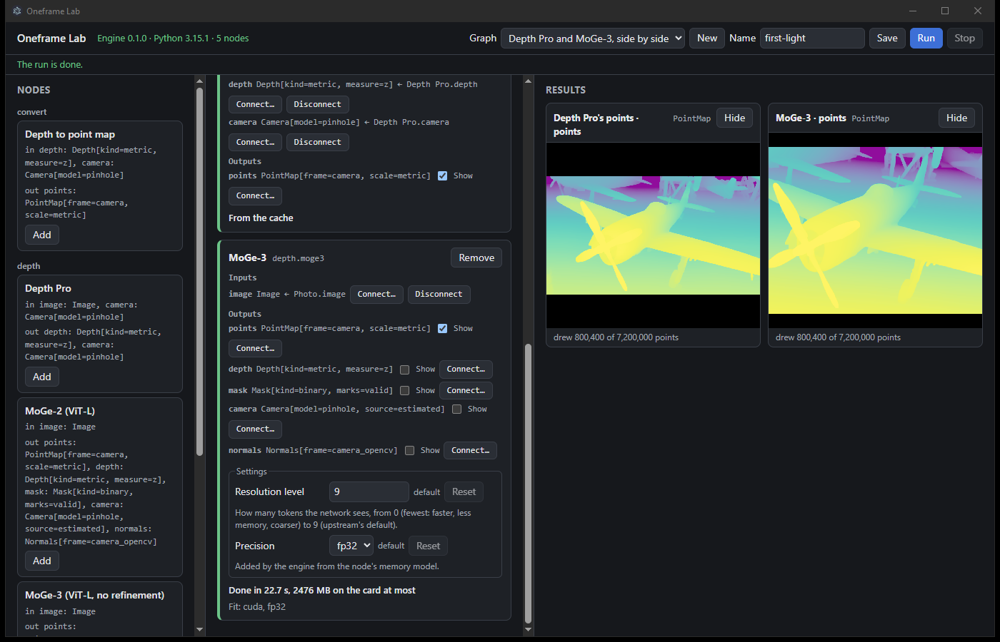
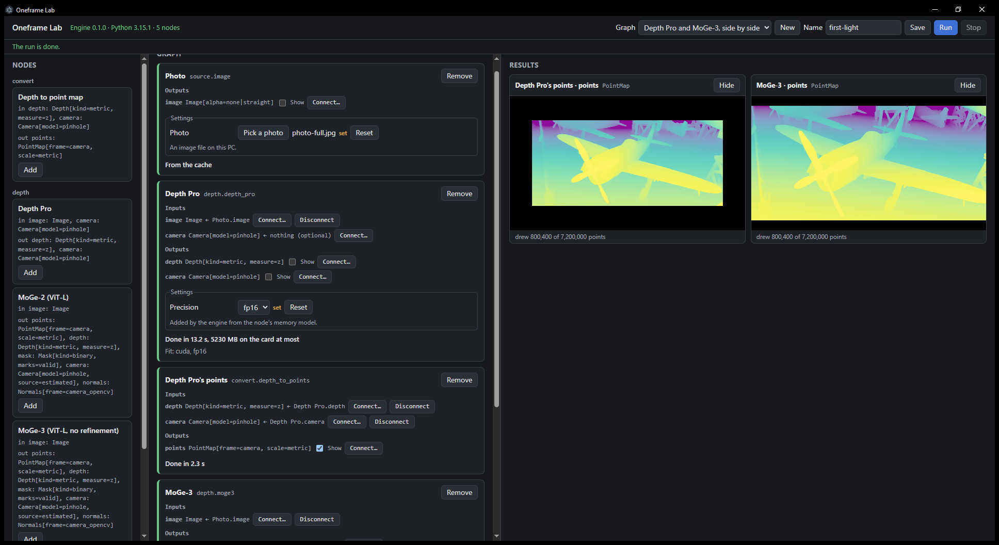

# 017 AC8: first light from the page, on the GTX 1070 — passed

2026-11-11, commit `d1c278a` (`main`), on the owner's PC. Machine-readable:
[2026-11-11-local.json](2026-11-11-local.json).

**Passed.** From a new, empty data root, outside Claude desktop's package, the shipped graph
"Depth Pro and MoGe-3, side by side" was opened on the page and a photo was picked. Both runtimes
were installed, and both models' files downloaded, from the cards' own offers. The run showed Depth
Pro's and MoGe-3's point clouds side by side: once with Depth Pro at fp32 on the processor, then at
fp16 on the card.

## The machine

| | |
| --- | --- |
| OS | Windows 10 Pro 10.0.19045.6466 |
| GPU | NVIDIA GeForce GTX 1070, compute 6.1, 8,192 MB, driver 582.66 |
| RAM | 31.9 GB (20.6 GB free at the start) |
| Card in use before the app | 397 MB: the desktop, browsers, Claude, Grok Bot; nothing heavy |
| Tools | Node 24.22.1, uv 0.13.5, engine Python 3.15.1, runtimes' Python 3.14.9, PowerShell 7.4.19 |
| Where | A pwsh window that Grok Bot started (explorer.exe > Grok Bot.exe > pwsh.exe > pwsh.exe), outside the package; `diagnose` named the root `D:\OneframeLab-017`, with no `\Packages\` in it |

## What ran

Verification steps 1 to 3 of the spec, from a script that logged each step and ran the commands
exactly: `npm ci` (26 s), `npm run engine:sync`, `ONEFRAME_DATA` set to the new folder, `npm start`
(open 6 h 4 min, exit 0), then `npm run diagnose`. On the page, runs 1 to 4 and their installs and
downloads were pressed on the cards' offers. Grok Bot, from a written prompt, set fp16 for run 5,
took both screenshots, and closed the app. Times below are local (UTC-5).

| Time | What | Outcome |
| --- | --- | --- |
| 14:16:38 | Run 1 | Photo imported (1.1 s). Both model cards failed `runtime`/`not_installed`, which offers Install; Depth Pro's points skipped |
| 14:16:59 | Install `depth_pro` | cu126, 4.53 GB, 173.0 s |
| 14:21:11 | Install `moge` | cu126, 4.75 GB, 81.1 s |
| 14:29:35 | Run 2 | Both failed `files`/`not_downloaded` (1.90 GB and 1.48 GB to fetch), which offers Download |
| 14:29:37 | Download Depth Pro's weights | The PC slept at 14:29:47 and woke at 18:35:37 (below); resumed, verified and placed at 18:36:22 |
| 18:36:26 | Run 3 | Depth Pro done on the processor; MoGe-3 failed `not_downloaded` |
| 18:38:56 | Download MoGe-3's weights | 28 s, verified and placed |
| 18:39:26 | Run 4 | Depth Pro cached; MoGe-3 done on the card; **the run is done**, both panes drawn |
| 20:06:55 | Run 5, Depth Pro set to fp16 | Depth Pro done on the card; MoGe-3 cached; **the run is done** |

## Each node: seconds, fit, peaks

| Step | Fit | Seconds | Peak on the card | Peak in RAM | Estimate (card / RAM) |
| --- | --- | --- | --- | --- | --- |
| Depth Pro, precision unset | cpu, fp32 (9,280 MB does not fit the card's 6,282 MB budget; warning: slow, 135 s, with cuda at fp16 as the alternative) | **114.6** | — | 8,901.8 MB | 9,280 / 9,280 MB |
| Depth Pro, fp16 set | cuda, fp16; ceiling 6,394 MB | **13.2** | 5,230.2 MB (6,186.6 reserved) | 2,657.4 MB | 6,259 / 2,657 MB |
| MoGe-3, level 9 | cuda, fp32; ceiling 6,405 MB | **22.7** | 2,475.8 MB (2,887.8 reserved) | 3,490.4 MB | 3,669 / 3,489 MB |
| Depth Pro's points | cpu | 5.4 (fp32 run), 2.3 (fp16 run) | — | 308.1 / 295.3 MB | — |

The fit changed no setting the person left alone. Both panes said "drew 800,400 of 7,200,000
points": a stride of 3, within the 1-million `POINT_BUDGET`. The spec expected about 110 s and
13 s; spec 005's bench measured 110.5 s and 12.8 s on the same photo.

## Screenshots

After run 4 (Depth Pro at fp32). Depth Pro's card is scrolled out of view, so its line here comes
from the journal:

After run 5 (Depth Pro at fp16): "Done in 13.2 s, 5230 MB on the card at most. Fit: cuda, fp16":

## Observations

None of these stops AC8.

1. **A 4-hour gap in Depth Pro's download was the PC sleeping.** The download got no bytes from
   14:29:48 to 18:35:45. The system log shows the PC entered sleep at 14:29:47 (Kernel-Power 42) and
   woke at 18:35:37 (Power-Troubleshooter 1). Eight seconds after waking, the connection was reset
   at 541,280,498 bytes (WinError 10054); the transport retried after 0.96 s, resumed from those
   bytes, and finished in 35 s. Nothing in the app keeps the machine awake while a download, an
   install or a run is going. Whether it should is a product question for the owner.
2. **The system peaks sit at their estimates:** MoGe-3 at 3,490.4 MB against 3,489 MB (1.4 MB
   over), and Depth Pro at fp16 at 2,657.4 MB against 2,657 MB (0.4 MB over). Both figures were
   fitted in spec 005 as the smallest that covered its bench's peaks on this photo (ratio 1.0
   there), so a run through the app lands on them. The fit's 3,429 MB system margin covers this.
   It belongs with the handoff's open item on MoGe's memory figure.
3. **The panes framed the clouds differently after run 5.** After run 4 both clouds filled their
   panes alike. After run 5, with the window maximized, Depth Pro's cloud was drawn smaller in its
   pane than MoGe-3's. It may be the linked camera kept across a pane's new value, or the two
   clouds' different scales; this run does not tell which.
4. **Depth Pro's fp32 warning on its card is not captured.** The journal holds it (slow, 135 s,
   cuda fp16 as the alternative), but neither screenshot shows Depth Pro's card at fp32.
5. **`npm start` downloaded Electron's binary** ("Downloading Electron binary...") on its first
   start after `npm ci`, rather than during the install.
6. Both nodes log PyTorch's "The given NumPy array is not writable" warning from
   `torch.from_numpy` (`node.py` lines 56 and 57); harmless here, since `.float()` makes a new
   tensor before anything writes. MoGe-3 logs "refiner is not enabled", as spec 005 ships it.

## Local changes

None. The checks passed on this commit before the run: `npm run check` (67 tests, docs check)
and `npm run engine:check` (676 passed, 4 skipped).
